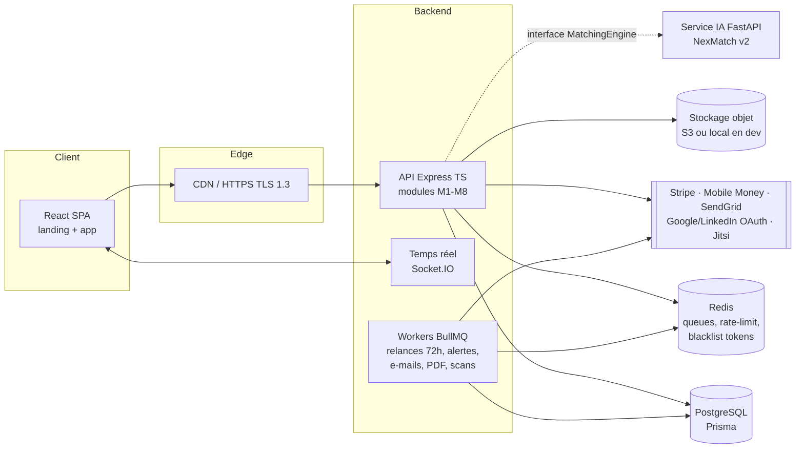

# NEXBRIDGE — Dossier de conception · Étape 1
## Document 2/4 — Architecture, arborescences et parcours utilisateurs

---

## 1. Architecture complète

### 1.1 Principe directeur
**Un monolithe modulaire bien découpé, plus un service IA séparé.** Le CDC demande des microservices ; pour une équipe réduite et un MVP à valider, ils multiplient le déploiement, la supervision et les cas d'échec sans bénéfice immédiat. Le monolithe est organisé en **modules à frontières strictes** (un module n'importe pas le code interne d'un autre, il passe par son interface publique), ce qui permet d'extraire Paiement ou Notifications plus tard sans réécriture. Seule l'IA reste un service à part : écosystème Python, cycle de vie et charge différents.



### 1.2 Pile technologique retenue (et écarts avec le CDC)
| Couche | Choix | Justification / écart |
|---|---|---|
| Front | React 18 + TypeScript, **Vite**, Tailwind CSS, shadcn/ui, React Router | Conforme CDC. Vite pour des bundles légers (connexions 3G). |
| État | **Zustand** (état d'interface) + **TanStack Query** (données serveur) | Zustand est dans le CDC ; TanStack Query ajoute cache, pagination et mises à jour optimistes (Kanban) qu'il faudrait sinon coder à la main. Seul ajout au CDC. |
| Formulaires | react-hook-form + **Zod** | Mêmes schémas Zod côté client et serveur (package partagé). |
| Glisser-déposer | dnd-kit | Accessible au clavier, léger. |
| Graphiques | Recharts | Radar, barres, courbes pour NexDash. |
| i18n | i18next (FR au lancement, EN prêt) | Voir D6. |
| Icônes | Lucide | Trait fin, proche des pictogrammes de la charte (fusée, équipe, poignée de main, toque, trophée, courbe). |
| Back | Node 24 LTS + Express 5 + TypeScript | Node 20 (CDC) est en fin de vie ; Node 24 est la LTS retenue. |
| Validation | Zod | CDC autorise « Joi ou Zod ». |
| ORM / BDD | Prisma + **PostgreSQL 15+** | Conforme CDC. **MongoDB retiré** : profils en JSONB. **Elasticsearch retiré** : recherche plein texte PostgreSQL. |
| Queues / cache | Redis 7 + BullMQ | Conforme CDC. **RabbitMQ retiré** (BullMQ suffit). |
| Temps réel | Socket.IO (repli en long-polling si WebSocket bloqué) | Chat, notifications, indicateurs de lecture. |
| Auth | Passport.js, JWT RS256, bcrypt (cost 12), otplib (TOTP) | Conforme CDC. |
| Fichiers | Interface `StorageProvider` : **S3** (prod), disque local (dev) ; URL signées ; `file-type` (MIME réel) ; antivirus ClamAV derrière une interface | Conforme CDC, avec repli local pour développer sans compte AWS. |
| PDF | pdfkit (factures, attestations, exports) | Léger, sans navigateur headless. |
| IA | Python 3.11 + FastAPI + sentence-transformers (multilingue) | Conforme CDC, phase 5. |
| Tests | Jest, Supertest, Playwright | Conforme CDC. |
| CI/CD | GitHub Actions (build, lint, tests) | Conforme CDC. |
| Conteneurs | Dockerfile + docker-compose fournis ; **Kubernetes : v2** | Docker n'est pas installé ici ; la dev locale n'en dépend pas. |

### 1.3 Structure du dépôt (monorepo pnpm)
```
NEXBRIDGE/
├── apps/
│   ├── web/                 # React SPA : landing + application
│   │   └── src/{app,features,components,lib,i18n,styles}
│   └── api/                 # Express + prisma/ (schema.prisma, migrations, seed)
│       └── src/
│           ├── modules/     # auth, users, companies, institutions, skills,
│           │                # challenges, matching, applications, teams,
│           │                # projects (nexspace), documents, messaging,
│           │                # deliverables, meetings, evaluations, badges,
│           │                # payments, notifications, dashboards, admin, cms
│           ├── platform/    # middlewares (auth, rbac, validate, rate-limit, audit),
│           │                # storage, mail, queue, realtime, logger, config
│           └── jobs/        # workers BullMQ
├── services/
│   └── ai/                  # FastAPI (phase 5)
├── packages/
│   ├── shared/              # schémas Zod, types, énumérations, matrice de permissions
│   └── config/              # tsconfig, eslint, tailwind preset (tokens de marque)
├── docs/                    # ce dossier + docs techniques + guides utilisateur
├── infra/                   # docker-compose, Dockerfiles, CI, procédure de déploiement
└── .env.example
```

### 1.4 Backend : couches et sécurité par défaut
Chaque requête traverse : **rate-limit → authentification (JWT) → autorisation (RBAC + appartenance au projet/à l'entreprise) → validation Zod → contrôleur → service (règles métier) → repository (Prisma) → journal d'audit si action sensible → événement métier**.

- **RBAC à deux niveaux.** (1) Permissions par rôle, définies une seule fois dans `packages/shared` et utilisées par l'API **et** par l'interface (menus, boutons). (2) Contrôle de **propriété / appartenance** : un étudiant n'accède à un projet que s'il en est membre (`ProjectMember`), une entreprise qu'aux défis de **son** organisation, un référent qu'aux étudiants de **son** établissement. Cela ferme la porte aux accès directs par identifiant (IDOR) ; chaque route a un test Supertest qui vérifie un 403 pour un utilisateur d'un autre périmètre.
- **Sessions.** Access token RS256 15 min ; refresh token 7 j en cookie `HttpOnly; Secure; SameSite=Strict` avec **rotation** et détection de réutilisation (toute la famille est révoquée) ; blacklist Redis à la déconnexion ; jeton CSRF sur les routes qui utilisent le cookie.
- **Anti brute-force.** 5 tentatives / 15 min par couple IP+compte, blocage 30 min ; CAPTCHA après 3 échecs (interface `CaptchaProvider`, désactivé tant qu'aucune clé n'est fournie, affichage explicite).
- **Entrées.** Validation Zod côté serveur sur toutes les routes, listes blanches de champs triables/filtrables, requêtes Prisma paramétrées (pas de SQL brut concaténé), sanitisation du texte riche (sortie échappée par React ; Markdown nettoyé avant affichage).
- **En-têtes.** Helmet (CSP stricte, HSTS), CORS limité aux origines configurées.
- **Fichiers.** Type MIME détecté sur le contenu (pas l'extension), liste blanche de formats, tailles plafonnées (chat 25 Mo, vidéo 200 Mo), nom de stockage aléatoire, analyse antivirus asynchrone (le fichier reste « en analyse » et non téléchargeable tant qu'il n'est pas déclaré sain si ClamAV est configuré), téléchargement par **URL signée courte** après contrôle de droits.
- **Données.** Champs sensibles chiffrés AES-256-GCM (n° NINEA/RCCM, secret 2FA, configuration d'intégrations) ; clé fournie par variable d'environnement, jamais dans Git ; logs avec masquage des données personnelles (pino `redact`).
- **RGPD / loi sénégalaise.** Consentements horodatés et versionnés, export des données personnelles, droit à l'oubli par **anonymisation** (les projets et évaluations d'autres personnes restent cohérents).
- **Audit.** Table append-only `AuditLog` (qui, quoi, quand, sur quoi, IP hachée) pour : connexions, changements de rôle, validations KYC/briefs/crédits, actions financières, modérations, exports.

### 1.5 Temps réel et tâches de fond
- **Socket.IO** : salons par projet et par utilisateur (`project:{id}`, `user:{id}`), authentifiés par le même jeton ; événements : message, tâche déplacée, notification, présence « en train d'écrire ».
- **Workers BullMQ** (processus séparé, même code) : relances de confirmation d'équipe toutes les 24 h et expiration à 72 h avec **remplacement automatique** ; alertes « projet en difficulté » ; envoi d'e-mails ; génération de PDF ; analyse antivirus ; archivage à 6 mois ; purge des tokens expirés.

### 1.6 Intégrations : un adaptateur par service, un mode « non configuré » explicite
| Service | Interface | Sans clé d'API |
|---|---|---|
| E-mail (SendGrid) | `MailProvider` | Les e-mails sont **écrits dans la console et dans une boîte « e-mails de développement »** visible par l'admin ; jamais envoyés ; bandeau explicite. |
| OAuth Google / LinkedIn | `OAuthProvider` | Boutons visibles mais désactivés avec « Non configuré » (jamais de faux succès). |
| Stockage (S3) | `StorageProvider` | Disque local (dev/staging uniquement). |
| Paiement carte (Stripe) | `PaymentProvider` | Mode test uniquement tant que les clés live ne sont pas fournies. |
| Orange Money / Wave / Free Money | `PaymentProvider` | Adaptateur vide : option affichée « Bientôt disponible », transaction impossible. |
| Virement bancaire | `PaymentProvider` (manuel) | Instructions de virement + **rapprochement manuel** par l'admin (flux réel). |
| Visioconférence | `MeetingProvider` | Lien de salle Jitsi généré ; intégration embarquée en phase 5. |
| Matching | `MatchingEngine` | Moteur de règles (v1) ; adaptateur HTTP vers FastAPI (v2) sélectionné par variable d'environnement. |
| Antivirus / CAPTCHA / SMS / Push | interfaces dédiées | Désactivés explicitement. |

### 1.7 Environnements et déploiement
- **development / staging / production**, un fichier `.env` par environnement (modèle `.env.example` documenté).
- **Seed de démonstration** : activé uniquement si `DEMO_MODE=true` ; **refus d'exécution si `NODE_ENV=production`** ; comptes de test créés avec des mots de passe générés et écrits dans un fichier local ignoré par Git, pas dans le code.
- **Déploiement** : (A) conforme CDC : AWS (conteneurs + RDS + S3 + CloudFront) ; (B) variante légère compatible avec votre usage de Cloudflare : front sur Cloudflare Pages / CDN, API et workers en conteneur, PostgreSQL géré. Choix final avec D5. La procédure pas-à-pas est un livrable de la phase 4.
- **Performance 3G** : découpage du code par route, polices Plus Jakarta Sans **auto-hébergées et sous-ensemble latin**, images WebP/AVIF avec `loading="lazy"`, pagination par curseur (20 éléments), squelettes de chargement, compression Brotli, cache HTTP agressif pour les ressources statiques.

---

## 2. Arborescence de la landing page (site public)

```
/                                   Accueil (toutes les sections ci-dessous sur une page défilante)
│   ├─ Hero · Problème/Solution · Comment ça marche (4 étapes)
│   ├─ Nos solutions (8 cartes) · Entreprises · Étudiants · Établissements
│   ├─ Marketplace (aperçu de défis réels publiés) · Chiffres clés (réels ou masqués)
│   └─ Témoignages · Partenaires · FAQ · Contact · Newsletter · Footer
│
├─ /comment-ca-marche               Parcours détaillé en 4 étapes (schéma)
├─ /entreprises                     Bénéfices + CTA « Déposer un défi »
├─ /etudiants                       Bénéfices + CTA « Rejoindre la communauté »
├─ /etablissements                  Bénéfices + CTA « Devenir partenaire académique »
├─ /experts-mentors                 Rôle du mentor + CTA d'inscription
├─ /solutions
│    ├─ /nexbrief   ├─ /nexmatch   ├─ /nexspace   ├─ /nexbadge
│    └─ /nexdash    ├─ /paiement   ├─ /profils    └─ /back-office
├─ /projets                         Marketplace publique (liste + filtres : secteur, durée, compétences, budget)
│    └─ /projets/:slug              Détail d'un défi public → « Postuler » exige un compte étudiant
├─ /faq   ·   /contact
├─ /mentions-legales  ·  /cgu  ·  /confidentialite  ·  /cookies
├─ /connexion  ·  /inscription (choix du rôle)  ·  /mot-de-passe-oublie  ·  /verification-email
└─ *  → 404
```
Navigation fixe (sticky) : logo · Accueil · Comment ça marche ? · Entreprises · Étudiants · Établissements académiques · Experts & Mentors · Découvrir les projets · Connexion · **[Rejoindre NEXBRIDGE]** ; menu burger sur mobile.
Contenus administrables depuis le back-office : témoignages, partenaires, FAQ, messages de contact reçus, abonnés newsletter.

---

## 3. Arborescence de l'application SaaS (`/app`)

Les menus affichés dépendent du rôle ; les routes sont protégées côté API **et** côté interface.

```
/app
├─ /dashboard                          NexDash (contenu selon le rôle)
├─ /onboarding                         Assistant de complétion de profil (≤ 5 étapes, selon le rôle)
├─ /notifications                      Centre de notifications
├─ /messages                           Boîte de messages (tous projets)
├─ /recherche                          Recherche globale (défis, projets, profils autorisés)
├─ /profil                             Mon profil (édition) · /profil/public/:slug (portfolio public)
├─ /parametres
│    ├─ /compte  ├─ /securite (mot de passe, 2FA)  ├─ /notifications
│    ├─ /confidentialite (consentements, export, suppression)  └─ /facturation
│
├─ /defis                              Marketplace (étudiants) · mes défis (entreprise)
│    ├─ /defis/nouveau                 Wizard NexBrief en 5 étapes (+ brouillon auto)
│    ├─ /defis/:id                     Détail + statut + historique
│    ├─ /defis/:id/modifier            (BROUILLON / EN_REVISION seulement)
│    ├─ /defis/:id/candidatures        Candidatures reçues
│    └─ /defis/:id/nexmatch            Top 3 équipes, mode manuel, validation
│
├─ /candidatures                       (étudiant) envoyées / acceptées / propositions d'équipe à confirmer
│
├─ /projets                            Liste de mes projets (actifs, terminés, en attente)
│    └─ /projets/:id                   ── NexSpace ──
│         ├─ /apercu                   Vue générale + progression
│         ├─ /tableau-de-bord          Synthèse (retards, jalons, derniers messages/docs, alertes)
│         ├─ /taches
│         │    ├─ ?vue=kanban  ?vue=liste  ?vue=calendrier
│         │    └─ /taches/:taskId      Fiche détaillée (panneau latéral)
│         ├─ /jalons
│         ├─ /documents                Dossiers, versions, aperçu
│         ├─ /messages                 Canaux, fils, mentions
│         ├─ /livrables                Workflow de validation
│         ├─ /reunions                 Planification, comptes rendus, Jitsi
│         ├─ /activite                 Fil d'activité
│         ├─ /equipe                   Membres, rôles, chef de projet, mentor
│         ├─ /rapports                 Rapports hebdomadaires du mentor
│         ├─ /evaluation               Évaluation finale, attestation
│         └─ /parametres               Droits, règles de validation des jalons
│
├─ /badges                             NexBadge : compétences, badges, certifications
│
├─ /entreprise                         (rôle Entreprise)
│    ├─ /profil-organisation  ├─ /collaborateurs  ├─ /paiements  └─ /factures
├─ /mentor                             (rôle Mentor)
│    ├─ /projets-supervises  ├─ /alertes  ├─ /rapports  ├─ /evaluations  └─ /disponibilites
├─ /academique                         (rôle Référent)
│    ├─ /etablissement  ├─ /cohortes  ├─ /etudiants  ├─ /projets-a-valider
│    ├─ /credits  ├─ /competences  └─ /rapports (export PDF / CSV)
│
└─ /admin                              (Admin / Super Admin)
     ├─ /tableau-de-bord       KPI + files de validation
     ├─ /utilisateurs          /entreprises-kyc   /etablissements
     ├─ /defis-a-valider       /projets
     ├─ /competences           /badges            /templates-de-briefs
     ├─ /moderation            /signalements
     ├─ /commissions           /abonnements       /transactions   /factures
     ├─ /rapports (exports CSV/Excel)              /journaux (audit)
     ├─ /contenus              (témoignages, partenaires, FAQ, messages, newsletter)
     └─ /configuration         (Super Admin : paramètres, intégrations, notifications, droits)
```

**Matrice d'accès simplifiée**
| Zone | Entreprise | Étudiant | Mentor | Référent | Admin | Super Admin |
|---|:-:|:-:|:-:|:-:|:-:|:-:|
| Marketplace (lecture) | ✔ (ses défis) | ✔ | ✔ | ✔ | ✔ | ✔ |
| Créer un défi | ✔ | – | – | – | – | – |
| Candidater | – | ✔ | – | – | – | – |
| NexSpace d'un projet | si membre | si membre | si assigné | si lié à un étudiant du projet | lecture | lecture |
| Cohortes / crédits | – | – | – | ✔ (son établissement) | ✔ | ✔ |
| Validation briefs / KYC | – | – | – | – | ✔ | ✔ |
| Configuration avancée, rôles | – | – | – | – | – | ✔ |

---

## 4. Parcours utilisateurs

### 4.1 Entreprise : « soumettre un défi »
1. Inscription (choix du rôle Entreprise) → vérification e-mail.
2. Onboarding : raison sociale, secteur, taille, pays/ville, description, logo, contacts (Directeur innovation, DRH…).
3. **KYC** : dépôt du NINEA et du registre de commerce → statut « en vérification » (≤ 48 h). Sans KYC validé : brouillons possibles, soumission bloquée.
4. Wizard NexBrief : (1) contexte → (2) périmètre et livrables → (3) équipe (2–8, compétences, niveau) → (4) calendrier et jalons → (5) budget (FCFA/EUR), modalités. Enregistrement automatique en brouillon, template sectoriel au choix.
5. Soumission → **EN_REVISION** → notification de la décision (publié, ou refusé avec motif et retour en brouillon).
6. Défi **PUBLIE** → candidatures reçues + page NexMatch (top 3 avec scores et explications) → validation de l'équipe (ou composition manuelle).
7. Attente des confirmations (suivi 72 h) → **kick-off** → [paiement selon D2] → accès à l'espace NexSpace.
8. Suivi : progression, jalons, livrables ; validation des livrables après passage par le mentor ; messagerie.
9. Clôture : évaluation (note globale + par étudiant), factures, historique.

### 4.2 Étudiant : « postuler et travailler »
1. Inscription → vérification e-mail → onboarding : établissement, filière, niveau, compétences (avec niveau), disponibilités, préférences sectorielles, portfolio.
2. Marketplace : recherche, filtres (secteur, durée, compétences, budget), « opportunités recommandées » sur le dashboard.
3. Détail d'un défi → **Postuler** (motivation) ou recevoir une **proposition NexMatch**.
4. Confirmation individuelle d'une proposition d'équipe (délai 72 h ; refus → l'étudiant suivant du classement est sollicité).
5. Projet lancé → NexSpace : tâches assignées, Kanban, dépôt de livrables, chat, réunions.
6. Fin de projet : auto-évaluation de l'expérience, évaluation des pairs → badges, attestation PDF, mise à jour du portfolio et des compétences.

### 4.3 Mentor : « superviser »
1. Inscription → profil professionnel (expertises, expérience, disponibilité = nombre de projets simultanés, tarif indicatif).
2. Affectation à un projet (par l'admin ; proposition possible côté entreprise) → accès NexSpace.
3. Suivi : tableau consolidé, indicateurs de santé, **alertes** (faible activité, jalons manqués).
4. Revue des livrables : annotation, demande de correction, approbation avant transmission à l'entreprise.
5. Rapport hebdomadaire (modèle), validation des jalons, évaluation des étudiants à la clôture.

### 4.4 Référent académique : « piloter les cohortes »
1. Inscription → rattachement à un établissement (validé par l'admin NEXBRIDGE) → filières gérées.
2. Cohortes : liste des étudiants inscrits, regroupements par promotion.
3. Suivi des projets de ses étudiants ; **validation académique** d'une équipe si requise (étape 4 du workflow).
4. En fin de projet : attribution de crédits (ECTS ou équivalent, champ libre + validation), suivi des compétences.
5. Rapports statistiques, export PDF/CSV.

### 4.5 Administrateur : « valider et piloter »
1. Tableau de bord : KPI réels, files de validation (KYC, briefs, badges, crédits, signalements).
2. **Valider un brief** : checklist (détail suffisant, budget, compétences, secteur, livrables) → publier ou refuser avec motif.
3. Valider KYC et établissements ; gérer utilisateurs (activer, désactiver, changer de rôle, envoyer un e-mail) ; modérer contenus et évaluations.
4. Gérer référentiel de compétences, définitions de badges, templates de briefs, commissions, transactions, rapports.
5. Super Admin : paramètres globaux, intégrations (clés chiffrées), droits, journaux d'audit complets.

### 4.6 Visiteur non connecté
Landing → marketplace publique (lecture) → clic sur « Postuler » → inscription **étudiant** avec retour au défi consulté → onboarding → candidature.
